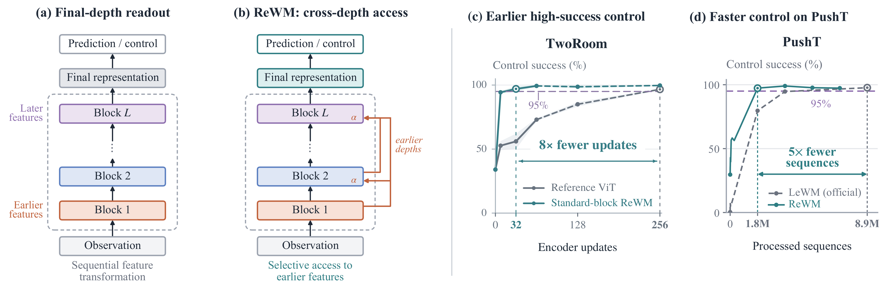
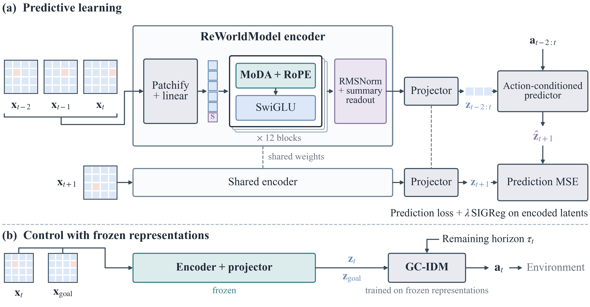

# ReWM: ReWorldModel

**Rethinking Visual Representation Learning in Latent World Models**

Yijing Wang\*, Lianghui Zhu\*, Hui Sun, Qian Zhang, Wenyu Liu, Xinggang Wang
(Huazhong University of Science and Technology; Horizon Robotics). \*Equal contribution.

<p align="center"></p>

Latent world models usually read only the final encoder depth, where fine-grained
details that control depends on have become hard to access. ReWM lets high-level
queries selectively retrieve features from earlier encoder depths through
Mixture-of-Depths Attention (MoDA) while the final representation is formed. The
predictive objective and the downstream interface stay unchanged.

| Task | Reacher | TwoRoom | Puzzle-3x3 | PushT | Cube |
|---|---:|---:|---:|---:|---:|
| ReWM, control success (%) | 100 | 100 | 100 | 99.0 | 100 |

Peak control success of the reported Full ReWM run per task (one encoder seed; PushT is the mean of three rollout banks).

- PushT reaches 95% success with 5x fewer processed training sequences than LeWM
  under its official recipe.
- Under one shared recipe and three paired seeds, adding cross-depth access (MoDA)
  and RoPE to the official encoder raises Reacher success at eight encoder updates
  from 23.3% to 97.7%, and reaches 95% with 8x fewer updates on Reacher and TwoRoom.
- On TwoRoom, the untrained ReWM encoder already supports 100% success, versus 27%
  for the untrained official encoder.

<p align="center"></p>

ReWM is a visual world model with cross-layer MoDA attention. This repository
contains the full encoder, the five selected task configurations, component
ablations, controlled LeWM+MoDA comparisons, the official-recipe LeWM baseline,
GC-IDM control evaluation, and frozen representation diagnostics.

The source is in [`rewm/`](rewm/). Datasets and model checkpoints must be obtained
separately.

## Contents

- [Installation](#installation)
- [Data preparation](#data-preparation)
- [Train ReWM](#train-rewm)
- [Ablations](#ablations)
- [LeWM comparisons](#lewm-comparisons)
- [Control evaluation](#control-evaluation)
- [Representation diagnostics](#representation-diagnostics)
- [Experiment settings and verification](#experiment-settings-and-verification)
- [Licenses](#licenses)

```text
ReWM/
  README.md
  rewm/
    src/                 ReWM encoder, world model, loss and training
    configs/full/        Five task configurations and schedule metadata
    controlled/          Controlled models and the official LeWM snapshot
    scripts/             Training, evaluation and data-preparation entry points
    evaluation/          Feature extraction, GC-IDM fitting and rollouts
    diagnostics/         Frozen probes and fixed frame/window index banks
    third_party/         MoDA/FLA source and license notices
    docs/                Data, protocol and implementation details
    requirements.txt
    SHA256SUMS
```

## Installation

The recorded environment uses Linux, Python 3.10, PyTorch 2.7.1 with CUDA 12.8,
Torchvision 0.22.1, and Triton 3.3.1. The MoDA kernels require an NVIDIA GPU.
Full ReWM and the controlled comparison use **eight GPUs**; the official LeWM
recipe uses one. Control evaluation uses one GPU per checkpoint.

From the repository root, create a separate environment:

```bash
python3.10 -m venv .venv
source .venv/bin/activate
export PYTHONNOUSERSITE=1
cd rewm

python -m pip install torch==2.7.1 torchvision==0.22.1 --index-url https://download.pytorch.org/whl/cu128
python -m pip install -r requirements.txt
python -m pip check
```

**Run the remaining commands from `rewm/`.** Keep `PYTHONNOUSERSITE=1` set to
prevent shared user packages from overriding the installed versions.

Check the source files before running experiments:

```bash
python scripts/verify_archive.py --strict
```

The launchers select the bundled MoDA/FLA source. For MuJoCo rollouts, the host
also needs a working EGL driver. The evaluation launcher sets the rendering
variables; for manual use:

```bash
export MUJOCO_GL=egl
export PYOPENGL_PLATFORM=egl
```

See [installation.md](rewm/docs/installation.md) for dependency, kernel import
and rendering details. Direct dependencies are pinned; this is not a complete
transitive environment lockfile.

## Data preparation

Place the prepared datasets under the directory passed as `--data-root`:

```text
data/
  reacher.h5
  dmc/reacher_random.h5
  tworoom.h5
  pusht_expert_train.h5
  ogbench/
    cube_single_expert.h5
    puzzle3x3_train.h5
    visual-puzzle-3x3-play-v0.npz
```

`reacher.h5` and `dmc/reacher_random.h5` must refer to the same dataset. If the
former is missing, create a relative symlink:

```bash
ln -s dmc/reacher_random.h5 /path/to/data/reacher.h5
```

The original public sources and required array layouts are described in
[data.md](rewm/docs/data.md) and [dataset_schema.json](rewm/docs/dataset_schema.json).
HDF5 frames are RGB uint8 images of shape `(N, 224, 224, 3)`. Keep the original
frame order, action/state columns and episode boundaries.

Convert the original Puzzle NPZ with:

```bash
python scripts/prepare_puzzle_data.py \
  --input /path/to/data/ogbench/visual-puzzle-3x3-play-v0.npz \
  --output /path/to/data/ogbench/puzzle3x3_train.h5
```

This repeats each 64-pixel image three times along each spatial axis, then
edge-pads it by 16 pixels per side. It preserves the historical action/state
conversion and episode layout. The uncompressed HDF5 needs about 151 GB for
the original dataset. Existing output files are refused. Keep the NPZ for
Puzzle rollout evaluation.

## Train ReWM

### Selected configurations

[`configs/full/`](rewm/configs/full/) contains the selected Full configurations.
All five use eight GPUs. The batch column below is the **global** batch size.

| Task argument | Encoder seed | Learning rate | Weight decay | Global batch | Default stop, updates |
|---|---:|---:|---:|---:|---:|
| `reacher` | 0 | 2e-4 | 1e-3 | 512 | 6398 |
| `tworoom` | 0 | 7e-4 | 1e-3 | 512 | 512 |
| `cube` | 60106 | 5e-4 | 2e-3 | 896 | 512 |
| `puzzle3x3` | 0 | 2e-4 | 1e-3 | 512 | 17260 |
| `pusht` | 3072 | 2.5e-4 | 1e-3 | 512 | 27864 |

Print a task's resolved configuration without loading data or starting CUDA:

```bash
python scripts/train.py --task reacher --arm full --config-only
```

Train with the selected task's default seed, hyperparameters and stopping budget:

```bash
python scripts/train.py --task reacher --arm full \
  --data-root /path/to/data \
  --output ../runs/reacher_full
```

Change `--task` to use another row in the table. Use a fresh output directory
for every run. Launch with plain `python`; Lightning starts the DDP workers.

To run only the first eight updates of the same schedule:

```bash
python scripts/train.py --task reacher --arm full \
  --data-root /path/to/data --output ../runs/reacher_full_step8 \
  --stop-after 8 --save-steps 0,8
```

`--stop-after` retains the original scheduler horizon. Reducing `max_epochs`
would change the learning-rate schedule. GPU count and per-device batch also
matter: SIGReg and projector BatchNorm operate on local batches. An eight-update
run is a training prefix, not a complete reproduction of every reported result.

The examples write outside `rewm/` so the source checksum checks remain usable.
Outputs include step-0 and requested update model objects, a final Lightning
checkpoint, resolved configuration, initialization hashes, the learning-rate
trace, and `TRAIN_COMPLETE.json`. Details are in
[training_core.md](rewm/docs/training_core.md).

## Ablations

Pass one of these names to `scripts/train.py --arm`:

| Arm | Change from Full |
|---|---|
| `full` | Complete ReWM |
| `full_no_moda_qknorm` | Remove the complete MoDA module, including QKNorm |
| `full_abspos` | Replace RoPE with learned absolute positions |
| `full_gelu_mlp` | Use a parameter-matched GELU FFN |
| `full_layernorm` | Replace RMSNorm with bias-free LayerNorm |
| `serial_multilevel_mean` | Remove MoDA and average normalized summary tokens from blocks 3/6/9/12 |
| `serial_multilevel_concat` | Remove MoDA, concatenate those tokens, and project 768 dimensions to 192 |

For a paired ablation, reuse the Full step-0 object and the same seed:

```bash
python scripts/train.py --task reacher --arm full_no_moda_qknorm \
  --seed 0 --data-root /path/to/data --output ../runs/reacher_no_moda_step8 \
  --stop-after 8 --save-steps 0,8 \
  --anchor ../runs/reacher_full_step8/lewm_full_ablation_step_0_object.ckpt
```

Without `--anchor`, the model is initialized from the specified seed. Exact
historical initialization replay needs the original step-0 object, which is
not included. Only load trusted model-object checkpoints.

## LeWM comparisons

The official and controlled experiments have separate recipes:

| Protocol | Models | Encoder seeds | GPUs | Global batch | LR | Schedule horizon |
|---|---|---|---:|---:|---:|---:|
| Official | Original LeWM | 3072 by default | 1 | 128 | 5e-5 | 100 epochs |
| Controlled | Reference LeWM / LeWM+MoDA | 78101, 78102, 78103 | 8 | 896 | 2e-4 (`--lr 3.5e-4` for the tuned runs) | 100 epochs |

The controlled pair uses weight decay 1e-3 and 16 warmup updates. The insertion
adds MoDA and RoPE to the standard LeWM block; it is a separate architecture
from Full ReWM.

Preview an official-recipe run stopped at update 512:

```bash
python scripts/train_comparison.py --protocol official --task reacher \
  --data-root /path/to/data --output ../runs/official_reacher \
  --stop-after 512 --dry-run
```

Remove `--dry-run` to train. Omitting `--stop-after` for the official protocol
runs its full training horizon. For the controlled protocol, the default
stopping budget is 512 updates.

Preview both controlled arms for each paired seed:

```bash
for seed in 78101 78102 78103; do
  for arm in reference lewm_moda; do
    python scripts/train_comparison.py --protocol controlled --task reacher \
      --arm "$arm" --seed "$seed" --data-root /path/to/data \
      --output "../runs/controlled_reacher_${arm}_${seed}" \
      --stop-after 512 --dry-run
  done
done
```

Use the same seed and budget for both arms. See
[experiment_map.md](rewm/docs/experiment_map.md) for architecture and budget
definitions, and [protocols.md](rewm/docs/protocols.md) for data-split settings.

## Control evaluation

The evaluator freezes one encoder checkpoint, extracts features, fits a GC-IDM
controller, and runs the task's rollout protocol:

```bash
python scripts/evaluate.py --task reacher --model-family full \
  --checkpoint ../runs/reacher_full/lewm_full_ablation_step_8_object.ckpt \
  --data-root /path/to/data --output ../outputs/reacher_full_step8 --gpu 0
```

Add `--dry-run` to inspect the commands. `--gpu` selects one physical CUDA/EGL
device. For separate stages, use `--stage extract`, `--stage train`, or
`--stage rollout` with the same checkpoint, output directory and settings.

Choose the model family that produced the checkpoint:

- `full`: Full ReWM and its component/readout ablations.
- `official`: the original official-recipe LeWM baseline.
- `controlled`: either arm of the paired standard-block comparison.

Controlled TwoRoom uses global feature stride 4; Full and official TwoRoom use
all frames. Both controlled arms must use the same setting:

```bash
python scripts/evaluate.py --task tworoom --model-family controlled \
  --feature-stride 4 --checkpoint /path/to/controlled_step512_object.ckpt \
  --data-root /path/to/data --output ../outputs/tworoom_controlled_step512 --gpu 0
```

Controllers train for 300 epochs with seed 42 and are selected by validation
action MSE. Reacher, TwoRoom and Cube use 100 rollouts with bank seed 42; Puzzle
uses 50. PushT uses three banks of 100 rollouts, with seeds 42, 93111 and 93112.
These three banks evaluate one encoder/controller, not three encoder seeds.

Outputs include `z.npz`, `idm.pt`, `idm_history.json`, stage logs,
`run_manifest.json`, `stage_status.json`, and `summary.json`. PushT and Puzzle
also write per-bank JSON files. Use a fresh output directory when changing
checkpoint or protocol. The launcher checks saved artifacts before reuse.

See [evaluation.md](rewm/docs/evaluation.md) for action horizons, data splits,
normalization and task-specific rollout details.

## Representation diagnostics

Frozen probes are available for Reacher, TwoRoom and PushT, with `full` or
`official` checkpoints. Run a small check first:

```bash
python scripts/probe.py --task reacher --architecture full \
  --checkpoint ../runs/reacher_full/lewm_full_ablation_step_8_object.ckpt \
  --data-h5 /path/to/data/dmc/reacher_random.h5 \
  --output ../outputs/reacher_full_step8_probe_smoke --device cuda:0 --smoke
```

Remove `--smoke` and choose a new output directory for the full diagnostic run.
The fixed index banks require the matching original HDF5 export. Probe
fit/validation/test episodes are disjoint; encoder exclusion is at window level.
See [diagnostics.md](rewm/docs/diagnostics.md) for readouts, target variables and
native prediction metrics.

## Experiment settings and verification

Full-versus-official compares
complete recipes, with different learning rates, batches and schedules. Keep
these results separate from the controlled paired comparison and from ablations.
The full definitions are in [protocols.md](rewm/docs/protocols.md).

Implementation checks include seven-arm 224-pixel forward/backward passes,
small Full optimizer updates and checkpoint reloads, real-checkpoint feature
extraction and probes, and short environment runs. They do not replace complete
training and formal rollout evaluations. A separate clean installation and all
paper results have not been rerun for this release. See
[validation.md](rewm/docs/validation.md) for the tested environment and scope.

`rewm/SOURCE_PROVENANCE.json` records source hashes. `rewm/SHA256SUMS` covers the
code package. The default verifier permits generated Python bytecode; `--strict`
also rejects those extra files. Keep experiment outputs outside the checked
source tree if you want to repeat strict verification after running.

## Licenses

First-party code in this repository is released under the MIT License (see
[LICENSE](LICENSE)); the GC-IDM adaptation and the other third-party
components keep their own licenses.
Third-party components retain their original licenses. The GC-IDM adaptation
uses CC BY-NC 4.0; this repository is not covered by a single MIT license.
Read [THIRD_PARTY_NOTICES.md](rewm/THIRD_PARTY_NOTICES.md) and the accompanying
license files before redistributing any component.

## Citation

```bibtex
@article{wang2026rewm,
  title   = {ReWorldModel: Rethinking Visual Representation Learning in Latent World Models},
  author  = {Wang, Yijing and Zhu, Lianghui and Sun, Hui and Zhang, Qian and Liu, Wenyu and Wang, Xinggang},
  journal = {arXiv preprint},
  year    = {2026}
}
```
